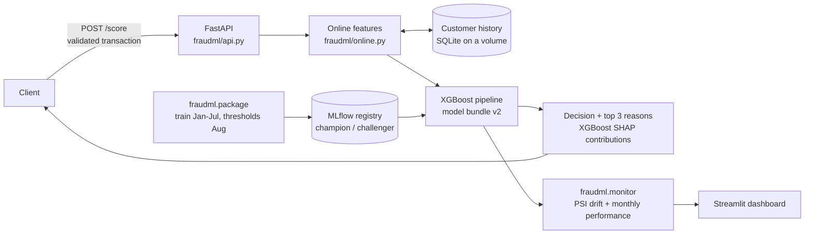
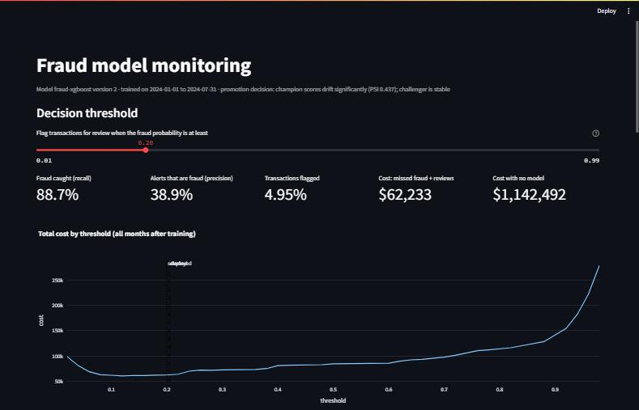
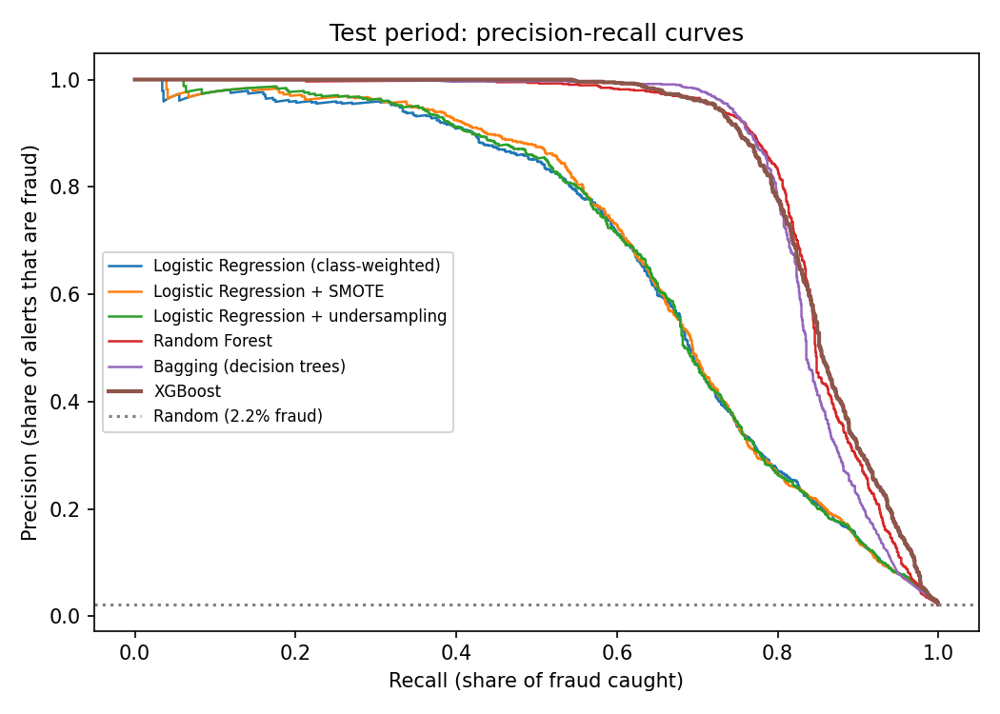

# Fraud Detection with MLflow Experiment Tracking

> Machine Learning coursework, The British University in Egypt, 2026. Author: Ziad Ayman.

Detecting fraudulent online card payments (300,000 transactions, **2.2% fraud**) the way a production team would, from experiments to a monitored scoring service: features built only from the past, a train / validation / test split by **time**, a decision threshold chosen on the validation month, a **money-based** evaluation, and every run tracked in **MLflow**. A second, small medical dataset (diabetes) shows how the same workflow behaves with 768 rows.

## From model to production

The model is served as a **FastAPI scoring service in Docker**, with a customer-history store, an MLflow model registry with a promotion gate, drift monitoring and a dashboard. Everything below was measured on the real data.



**1. No training/serving skew.** The behavioural features (a customer's previous purchases, average amount, time since the last purchase, country changes) are computed in bulk with pandas for training, but one transaction at a time in production from a small per-customer store. Replaying all **299,695 transactions** through the online path gives **zero mismatches** with the training features across all 23 features (`results/online_offline_parity.json`), and tests check the same on edge cases (two purchases in the same second, a zero profile average, a restart of the store).

**2. Monitoring found a flaw in the first production model, and the registry gate was fixed with it.** Population Stability Index (PSI) of the model's scores against the training period showed the first version drifting every month:

| Month | v1 score PSI | v1 recall | v1 flag rate | v2 score PSI | v2 recall | v2 flag rate |
|---|---|---|---|---|---|---|
| August | 0.155 (moderate) | 89.7% | 4.15% | 0.001 | 90.5% | 4.90% |
| September | 0.312 (significant) | 85.7% | 3.87% | 0.000 | 88.0% | 4.89% |
| October | 0.437 (significant) | 84.7% | 3.52% | 0.001 | 87.2% | 4.71% |

The cause was one feature: the number of the customer's previous purchases **since the data began**, which grows every month (average 2.5 in January, 47 in October), so later traffic fell outside anything seen in training. Removing it cost 0.001 PR-AUC (0.8577 to 0.8566), removed the drift, and lowered the test-period cost from $46,719 to **$44,725** at the cost-optimal threshold. A 30-day count was also tested as a replacement and added nothing, so the feature was dropped. The first registry rule compared PR-AUC only and would have kept the drifting model, so the promotion gate now also requires stable scores (`fraudml/package.py::should_promote`). Version 2 was promoted with the recorded reason *"champion scores drift significantly (PSI 0.437); challenger is stable"*.

**3. The scoring service reproduces the offline evaluation.** All 299,695 transactions were replayed in time order through the running container's HTTP API, which built its own customer history: September–October PR-AUC is **0.8566**, identical to the offline evaluation.

| Released model (v2), September–October | Value |
|---|---|
| PR-AUC / ROC-AUC | 0.857 / 0.977 |
| At the cost-optimal threshold (0.20): recall, precision, flagged | 87.6%, 40.0%, 4.8% of transactions |
| Total cost (missed fraud + $5 per review) | **$44,725** vs $771,538 with no model |

**4. Performance.** Median latency of `POST /score` measured inside the container: **7.8 ms**, or 14.4 ms with per-transaction explanations. Batch scoring replays all 300,000 transactions in 24 seconds (**12,600 transactions per second**); before history writes were committed once per batch instead of once per transaction, it took 15 minutes (329 per second). From the Windows host, requests take about 52 ms because Docker Desktop's port forwarding adds about 44 ms per request with a body; the same client code inside the container takes 7.8 ms (`results/latency.json`).



**Serving API**

```bash
curl -X POST localhost:8000/score -H "Content-Type: application/json" -d '{"transaction_id": 1, "user_id": 7,
  "account_age_days": 40, "avg_amount_user": 80, "amount": 1500, "country": "FR", "bin_country": "US", "channel": "web",
  "merchant_category": "electronics", "promo_used": 0, "avs_match": 0, "cvv_result": 0, "three_ds_flag": 0,
  "transaction_time": "2024-10-01T02:14:00Z", "shipping_distance_km": 2500}'
```

The response holds the fraud probability, the decision (`review` or `approve`) at the deployed threshold, the top three reasons (for example "shipping distance raises risk") and the model version. Every field is validated (types, ranges, allowed values, a timezone on the timestamp, no unknown fields); invalid input gets HTTP 422 with the reason. `POST /score/batch` takes up to 1,000 transactions, `GET /model` returns the version, thresholds and test metrics, and `GET /health` reports the live flag rate. `update_history=false` scores without recording the transaction.

## Experiments: model comparison (test period September–October 2024, 60,194 transactions)

This comparison uses the full feature set (the production model drops one drifting feature, see above).

| Model | PR-AUC | ROC-AUC | Precision | Recall | F1 | Fraud caught at 1% false alarms |
|---|---|---|---|---|---|---|
| **XGBoost (GPU, tuned)** | **0.858** | **0.977** | 0.911 | 0.749 | 0.822 | 82.7% |
| Random Forest | 0.853 | 0.970 | 0.919 | 0.760 | **0.832** | **83.4%** |
| Bagging (decision trees) | 0.844 | 0.961 | 0.914 | 0.759 | 0.830 | 82.4% |
| Logistic Regression + SMOTE | 0.685 | 0.957 | 0.768 | 0.571 | 0.655 | 65.9% |
| Logistic Regression + undersampling | 0.682 | 0.957 | 0.758 | 0.571 | 0.651 | 66.1% |
| Logistic Regression (class-weighted) | 0.678 | 0.957 | 0.770 | 0.572 | 0.656 | 65.6% |

Models were trained on January–July and thresholds chosen on August, then frozen and applied to September–October. **PR-AUC** is the main metric: with 2.2% fraud, ROC-AUC looks excellent for every model (0.96–0.98) and hides the real difference, which precision-recall shows clearly.



### The money view
Each missed fraud costs its transaction amount, and each flagged transaction costs $5 to review manually. Choosing the threshold that minimises that cost on the validation month, then applying it to the test months:

| | Total cost (two months) |
|---|---|
| No model (all fraud goes through) | $771,538 |
| XGBoost, F1-optimal threshold | $82,184 |
| **XGBoost, cost-optimal threshold** | **$46,719** (catches 85% of fraud, flags 3.7% of transactions) |

The cost-optimal threshold flags more transactions than the F1-optimal one, because a $5 review is much cheaper than an average missed fraud: **94% lower losses than no model**.

### What drives the score (SHAP)


The strongest fraud signals are long shipping distances (the top quarter has 6 times the fraud rate of the rest), failed address, CVV and 3-D Secure checks, payments on the website rather than the app (3.6% vs 0.8% fraud), accounts younger than about 18 months (5.2% vs 1.2%), and a card issued in a different country from the purchase (11.3% vs 1.4%).

## Results: diabetes (768 patients, 5-fold cross-validation repeated 5 times)

| Model | ROC-AUC | F1 | Recall |
|---|---|---|---|
| Random Forest | **0.837 ± 0.033** | 0.673 | 0.687 |
| Logistic Regression | 0.834 ± 0.035 | 0.671 | **0.721** |
| XGBoost | 0.824 ± 0.035 | 0.662 | 0.683 |

On a dataset this small, all three models are within one standard deviation of each other: Logistic Regression is as good as the ensembles and much easier to explain. Zeros in Glucose, Blood Pressure, Skin Thickness, Insulin and BMI mean "not measured" (Insulin is missing for 374 of 768 patients), so they are treated as missing values and imputed inside each fold.

## Engineering decisions
- **No leakage from the future.** Behavioural features (number of the user's previous transactions, their previous average amount, hours since their last transaction, previous country changes) use only earlier transactions; a test checks that removing future rows changes nothing. The dataset's `total_transactions_user` column counts the user's transactions over the whole ten months, so it is **not used**.
- **Time-based split** instead of a random one, so the model is always evaluated on a later period than it was trained on.
- **Leakage-safe pipelines.** Imputation, scaling, encoding and resampling (SMOTE, undersampling) are fitted on the training data only.
- **XGBoost on the GPU** (RTX 3060): 3 seconds to train on 209,000 transactions. A 30-configuration random search scored on the validation month chose depth 4, learning rate 0.02 and about 750 trees; the square root of the class ratio as class weight worked better than the full ratio.
- **MLflow** records every run's parameters and metrics in a local SQLite store, and its model registry holds the production versions with "champion" and "challenger" aliases.

## Run it
```bash
pip install -r requirements.txt
# place transactions.csv and diabetes.csv in data/
python -m fraudml transactions          # experiments: all six models (uses the GPU if available)
python -m fraudml diabetes
python -m fraudml.package               # production model: train, register in MLflow, export models/fraud_xgboost
python -m fraudml.monitor               # drift and monthly performance report, scores for the dashboard
mlflow ui --backend-store-uri sqlite:///mlflow.db   # runs and the model registry at http://localhost:5000
python -m pytest -q                     # 26 tests
```

Serve and monitor:
```bash
docker build -t fraud-api .
docker run -p 8000:8000 -v "$PWD/models:/models:ro" -v fraud-history:/state fraud-api
pip install -r requirements-dashboard.txt && streamlit run dashboard/app.py
```
The serving image (735 MB) pins scikit-learn and XGBoost to the versions the bundle was trained with; the bundle records those versions and warns on a mismatch.

## Project structure
```
fraudml/
├── data.py       # loading, schema check, diabetes zero handling, time split
├── features.py   # past-only behavioural features (offline, for training)
├── online.py     # the same features one transaction at a time, from a SQLite customer-history store
├── models.py     # pipelines: logistic regression, resampling, random forest, bagging, XGBoost
├── evaluate.py   # PR-AUC, F1 and cost-optimal thresholds, recall at 1% false alarms, cost
├── package.py    # production training, MLflow registry with a promotion gate, serving bundle
├── serving.py    # scoring service: online features, model, decision, per-transaction reasons
├── api.py        # FastAPI app with request validation
├── monitor.py    # PSI drift and monthly performance against the training period
└── __main__.py   # experiments command line, MLflow tracking, figures, SHAP
dashboard/        # Streamlit monitoring dashboard
tests/            # features, online/offline parity, thresholds, promotion gate, PSI, service and API
notebooks/        # the original coursework notebook
```

## What changed from the original coursework
The original notebook (kept in `notebooks/`) split the data randomly, used a fixed 0.5 threshold and reported bagging as best (F1 0.83, ROC-AUC 0.975). This version rebuilds it as a tested package with a time-based split, past-only features, tuned GPU XGBoost, validation-chosen thresholds, a cost analysis and SHAP explanations. The ensemble models reach the same F1 on a harder, more realistic evaluation, and the cost analysis shows what that means in money.

## Related project
The same Machine Learning course's second fraud problem, vehicle insurance claims (15,420 claims, 6% fraud), is in [insurance-claim-fraud-detection](https://github.com/ZIADAYMAN81/insurance-claim-fraud-detection): evaluated on a future year, with SMOTE, GPU XGBoost, bootstrap confidence intervals and MLflow tracking.

## Tech stack
Python · scikit-learn · XGBoost (CUDA) · imbalanced-learn · MLflow (tracking and registry) · FastAPI · pydantic · SQLite · Docker · Streamlit · Plotly · SHAP · pandas · NumPy · pytest
