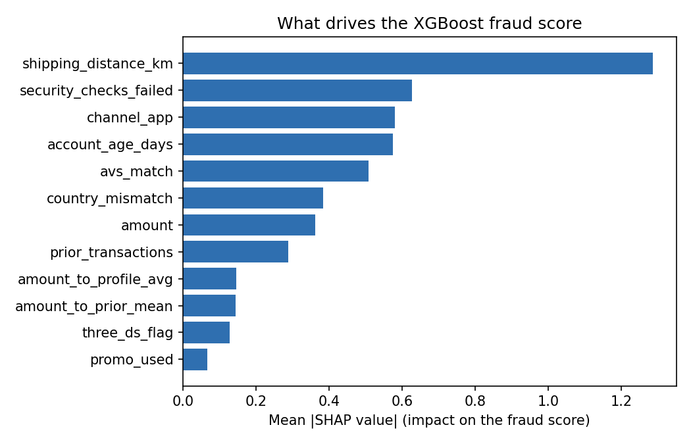

# Fraud Detection with MLflow Experiment Tracking

> Machine Learning coursework, The British University in Egypt, 2026. Author: Ziad Ayman.

Detecting fraudulent online card payments (300,000 transactions, **2.2% fraud**) the way a production team would: features built only from the past, a train / validation / test split by **time**, a decision threshold chosen on the validation month, a **money-based** evaluation, and every run tracked in **MLflow**. A second, small medical dataset (diabetes) shows how the same workflow behaves with 768 rows.

## Results: transactions (test period September–October 2024, 60,194 transactions)

| Model | PR-AUC | ROC-AUC | Precision | Recall | F1 | Fraud caught at 1% false alarms |
|---|---|---|---|---|---|---|
| **XGBoost (GPU, tuned)** | **0.858** | **0.977** | 0.911 | 0.749 | 0.822 | 82.7% |
| Random Forest | 0.853 | 0.970 | 0.919 | 0.760 | **0.832** | **83.4%** |
| Bagging (decision trees) | 0.844 | 0.961 | 0.914 | 0.759 | 0.830 | 82.4% |
| Logistic Regression + SMOTE | 0.685 | 0.957 | 0.768 | 0.571 | 0.655 | 65.9% |
| Logistic Regression + undersampling | 0.682 | 0.957 | 0.758 | 0.571 | 0.651 | 66.1% |
| Logistic Regression (class-weighted) | 0.678 | 0.957 | 0.770 | 0.572 | 0.656 | 65.6% |

Models were trained on January–July and thresholds chosen on August, then frozen and applied to September–October. **PR-AUC** is the main metric: with 2.2% fraud, ROC-AUC looks excellent for every model (0.96–0.98) and hides the real difference, which precision-recall shows clearly.


### The money view
Each missed fraud costs its transaction amount, and each flagged transaction costs $5 to review manually. Choosing the threshold that minimises that cost on the validation month, then applying it to the test months:

| | Total cost (two months) |
|---|---|
| No model (all fraud goes through) | $771,538 |
| XGBoost, F1-optimal threshold | $82,184 |
| **XGBoost, cost-optimal threshold** | **$46,719** (catches 85% of fraud, flags 3.7% of transactions) |

The cost-optimal threshold flags more transactions than the F1-optimal one, because a $5 review is much cheaper than an average missed fraud: **94% lower losses than no model**.

### What drives the score (SHAP)


The strongest fraud signals are long shipping distances (the top quarter has 6 times the fraud rate of the rest), failed address, CVV and 3-D Secure checks, payments on the website rather than the app (3.6% vs 0.8% fraud), accounts younger than about 18 months (5.2% vs 1.2%), and a card issued in a different country from the purchase (11.3% vs 1.4%).

## Results: diabetes (768 patients, 5-fold cross-validation repeated 5 times)

| Model | ROC-AUC | F1 | Recall |
|---|---|---|---|
| Random Forest | **0.837 ± 0.033** | 0.673 | 0.687 |
| Logistic Regression | 0.834 ± 0.035 | 0.671 | **0.721** |
| XGBoost | 0.824 ± 0.035 | 0.662 | 0.683 |

On a dataset this small, all three models are within one standard deviation of each other: Logistic Regression is as good as the ensembles and much easier to explain. Zeros in Glucose, Blood Pressure, Skin Thickness, Insulin and BMI mean "not measured" (Insulin is missing for 374 of 768 patients), so they are treated as missing values and imputed inside each fold.

## Engineering decisions
- **No leakage from the future.** Behavioural features (number of the user's previous transactions, their previous average amount, hours since their last transaction, previous country changes) use only earlier transactions; a test checks that removing future rows changes nothing. The dataset's `total_transactions_user` column counts the user's transactions over the whole ten months, so it is **not used**.
- **Time-based split** instead of a random one, so the model is always evaluated on a later period than it was trained on.
- **Leakage-safe pipelines.** Imputation, scaling, encoding and resampling (SMOTE, undersampling) are fitted on the training data only.
- **XGBoost on the GPU** (RTX 3060): 3 seconds to train on 209,000 transactions. A 30-configuration random search scored on the validation month chose depth 4, learning rate 0.02 and about 750 trees; the square root of the class ratio as class weight worked better than the full ratio.
- **MLflow** records every run's parameters and metrics in a local SQLite store (`--log-models` also stores the fitted pipelines).

## Run it
```bash
pip install -r requirements.txt
# place transactions.csv and diabetes.csv in data/
python -m fraudml transactions                 # all six models; uses the GPU if available
python -m fraudml diabetes
mlflow ui --backend-store-uri sqlite:///mlflow.db   # compare runs at http://localhost:5000
python -m pytest -q                            # 8 tests
```

## Project structure
```
fraudml/
├── data.py       # loading, schema check, diabetes zero handling, time split
├── features.py   # past-only behavioural features, security and location features
├── models.py     # pipelines: logistic regression, resampling, random forest, bagging, XGBoost
├── evaluate.py   # PR-AUC, F1 and cost-optimal thresholds, recall at 1% false alarms, cost
└── __main__.py   # command line, MLflow tracking, figures, SHAP
tests/            # past-only features, split ordering, thresholds and cost, end-to-end run with MLflow
notebooks/        # the original coursework notebook
```

## What changed from the original coursework
The original notebook (kept in `notebooks/`) split the data randomly, used a fixed 0.5 threshold and reported bagging as best (F1 0.83, ROC-AUC 0.975). This version rebuilds it as a tested package with a time-based split, past-only features, tuned GPU XGBoost, validation-chosen thresholds, a cost analysis and SHAP explanations. The ensemble models reach the same F1 on a harder, more realistic evaluation, and the cost analysis shows what that means in money.

## Tech stack
Python · scikit-learn · XGBoost (CUDA) · imbalanced-learn · MLflow · SHAP · pandas · NumPy · matplotlib · pytest
